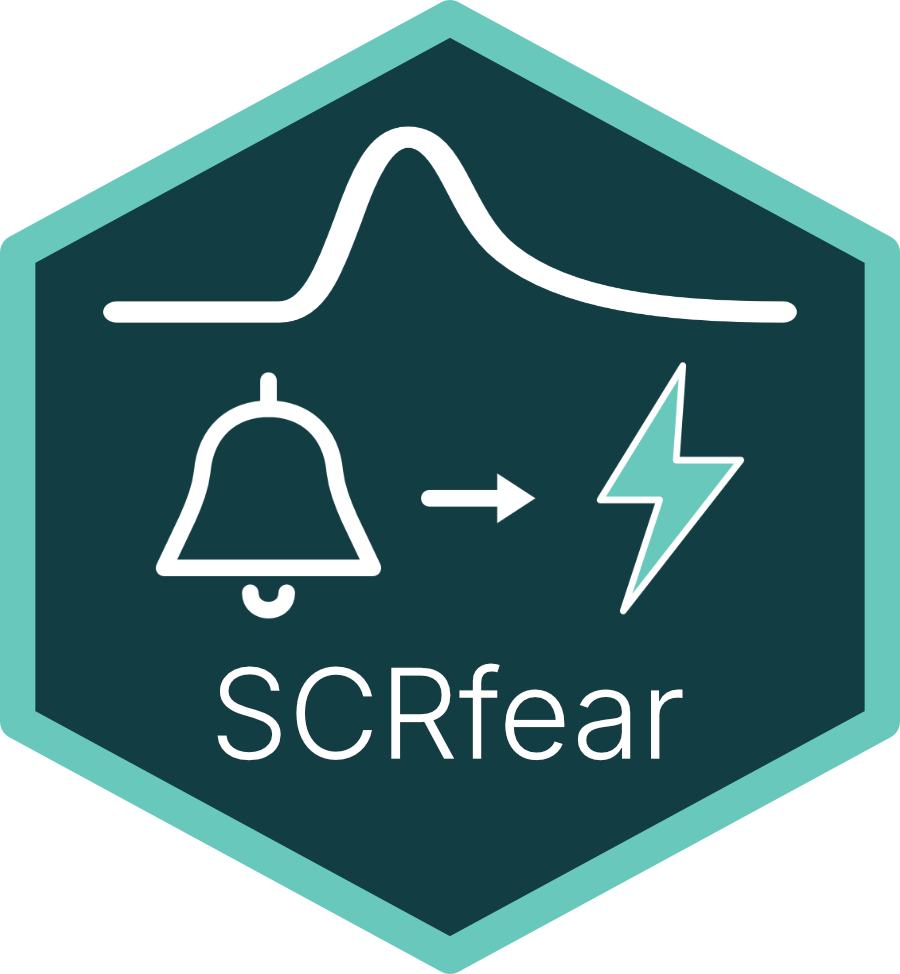

# SCRfear


Continuous SCR data from N = 543 participants undergoing fear acquisition with different ISIs and different settings, combining data from 17 experiments.
 
## Description

SCRfear converts public fear-conditioning skin-conductance datasets from the
[PsPM open data collection](https://bachlab.github.io/PsPM/opendata/) to the
[M-BIDS](https://github.com/bachlab/M-BIDS) format consistent with
[BIDS](https://bids.neuroimaging.io/), and can combine them into a single
corpus. The source datasets are downloaded from Zenodo.
Dataset-specific differences are defined in configuration.

The current configurations cover:

- CFG1
- CFG2
- DoxAv2
- DoxMemP
- DoxMem1
- DoxMem2
- FER01
- FER02
- FR
- FSS6B
- LI
- LSOA
- MinAv
- PubFe
- SC4B
- TC
- VC7B

Only acquisition blocks are converted. Experimental blocks become BIDS
`run-*` recordings; no `ses-*` directory is created. Event files are stored in
the same `physio` directory as their corresponding SCR recording.

## Set-up

SCRfear requires Python 3.10 or newer. Clone the repository, then create a
virtual environment and install the project from the repository root:

```powershell
git clone https://github.com/bachlab/SCRFear.git
cd SCRFear
python -m venv .venv
.\.venv\Scripts\Activate.ps1
python -m pip install -e .
```

On macOS or Linux, activate the environment with
`source .venv/bin/activate` instead.

Run all `scrfear` commands from the repository root. The default data
locations and the files in `metadata/` are resolved relative to the current
directory.

## Download, convert, and combine

Download a dataset's `Data.zip` from Zenodo:

```powershell
scrfear download FER02
```

Download all configured datasets:

```powershell
scrfear download all
```

This retains both the downloaded archives and extracted files, so downloading
all datasets requires substantial disk space.

Or place a manually downloaded and extracted dataset under
`Datasets/<dataset>/`. The converter accepts MAT files in the dataset folder,
`Data`, or `Data/Data`.

Convert one or more datasets:

```powershell
scrfear convert FER02
scrfear convert FER01 FER02 FR
```

Convert every configured dataset:

```powershell
scrfear convert all
```

Combine all converted datasets into one corpus:

```powershell
scrfear combine
```

Specific converted datasets can also be combined:

```powershell
scrfear combine CFG1 CFG2
```

The corpus uses new consecutive participant IDs. `Corpus/participants.tsv`
records each participant's source dataset and original ID, and
`Corpus/scrfear_corpus_overview.csv` provides the same mapping in a compact
three-column table. The participant list in
`converter/data/SCRopt_ppids.csv` is applied during corpus creation and should
produce 543 participants. DoxMem1, DoxAv2, and MinAv are limited to their
placebo groups. Use `--force` to rebuild an existing corpus.

Use `--subjects` for a small test conversion:

```powershell
scrfear convert FER02 --subjects 01 02
```

The default output locations are:

- Downloaded data: `Datasets/<dataset>/`
- Separate BIDS datasets: `Converted_Datasets/<dataset>/`
- Combined corpus: `Corpus/`

These locations can be changed:

```powershell
scrfear convert FER02 --raw-dir D:\SCR-data --output-dir D:\SCR-BIDS
scrfear combine --input-dir D:\SCR-BIDS --output-dir D:\SCR-Corpus
```

Combining copies the converted participant directories, so the corpus requires
additional disk space.

Use command-specific help to see all options and their defaults:

```powershell
scrfear download --help
scrfear convert --help
scrfear combine --help
```

## Source data and citation

SCRfear does not include any physiological data. Each dataset is downloaded
from its Zenodo record, and the record's licence and citation apply to the
data. Every converted dataset lists its authors and Zenodo source in
`dataset_description.json`. Please cite the original datasets when you use
the converted data, and cite [de Vries et al. (2026). preprint](https://osf.io/preprints/psyarxiv/abe4t) for the collection.

## Tests

```powershell
python -m unittest discover -s tests
```

## Dataset configuration

All dataset-specific settings, such as file patterns, experimental blocks,
stimuli and exclusions, are defined in `converter/lib/tsv_configs.py`.
